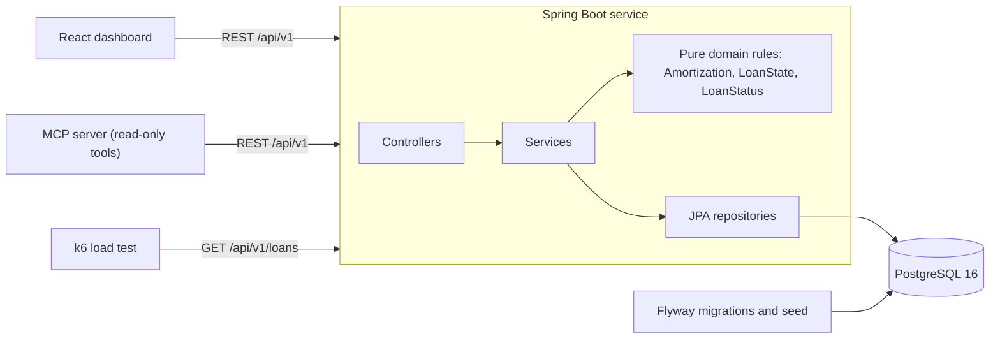

# LoanLedger

A cloud-native mortgage-servicing microservice: post payments, track escrow and move loans through loss mitigation, with a React dashboard on top.

[](https://github.com/abhiramvedipala/loanledger/actions/workflows/ci.yml)

All data is synthetic. The seed is generated with a fixed random seed, and every email is `@example.com`.

## Problem

After a mortgage closes, a servicer collects the payments for the next 30 years. Each payment has to be split correctly between interest, principal and escrow; people pay late, pay part, or pay extra; and borrowers in hardship move through forbearance or modification under strict rules. A wrong split or an illegal status change is a real financial and compliance problem.

LoanLedger is a small version of that system for a servicing operations team. I built it to practice the parts of backend work that matter when the data is money: exact decimal arithmetic, invariants enforced in the database, concurrency safety and clear API errors.

## Demo

Loans table with status chips:


Loan detail with the balance chart, payment form and loss-mitigation actions:


## Architecture



A request hits a controller, where Bean Validation rejects bad input as an RFC 7807 problem. The service loads the loan and hands its state to `LoanState`, a pure class that holds the money rules. The service then saves the new state and the payment in one transaction, and a `@Version` column turns a concurrent write into a 409. Spring serves the built dashboard from the same jar, so there is a single deployable, which runs under Compose or Kubernetes.

## Tech stack

| Tool | What it's used for | Why I chose it |
|---|---|---|
| Java 21, Spring Boot 3.5 | REST service | Mature, typed, and standard for financial backends |
| Spring Data JPA, Hibernate | Persistence | Optimistic locking and paging with little code; schema validation only |
| PostgreSQL 16 | System of record | `NUMERIC` money, check constraints and partial unique indexes |
| Flyway | Migrations and seed | Versioned schema, and its lock makes the seed safe with several replicas |
| springdoc-openapi | Swagger UI and OpenAPI JSON | Docs generated from the code can't drift from it |
| JUnit 5, Testcontainers | Tests | Integration tests run on real Postgres, not an in-memory lookalike |
| React, TypeScript, Vite | Dashboard | Typed client and a fast build; no router or chart library was needed |
| Docker, Compose | Packaging and local run | One command runs the whole stack |
| Kubernetes, kind | Deployment | Real manifests with probes and autoscaling, testable on a laptop |
| GitHub Actions | CI | Build, test and image build on every push |
| k6 | Load test | Scriptable, and its JSON summary feeds `RESULTS.md` directly |
| Python MCP SDK | Read-only tool server | Lets MCP clients query loans through the API's rules |

## Quick start

Prerequisite: Docker. Then:

```bash
docker compose up --build
```

- Dashboard: <http://localhost:8080/>
- Swagger UI: <http://localhost:8080/swagger-ui.html>
- Health: <http://localhost:8080/actuator/health>

Postgres is published on host port 5433. Set `APP_PORT` or `DB_PORT` if those ports are taken. To run the tests or the checks you also need Java 21 (`brew install openjdk@21`, then set `JAVA_HOME`), Node 22 and Python 3.

## Results

Every number comes from a script. This table is generated, and `scripts/check.sh` fails if it drifts from the raw files in `results/`. See [RESULTS.md](RESULTS.md) for how to re-run them and what the load test numbers do and don't mean.

<!-- results:start -->
| Metric | Value | Source |
|---|---|---|
| API endpoints (OpenAPI operations) | 11 | `scripts/count.sh` |
| Automated tests | 38 | `scripts/count.sh` |
| Test failures | 0 | `scripts/count.sh` |
| MCP server tests | 4 | `scripts/count.sh` |
| `GET /api/v1/loans` p95 latency | 61.77 ms | `scripts/results.sh` |
| `GET /api/v1/loans` median latency | 19.64 ms | `scripts/results.sh` |
| Throughput | 788 requests/s | `scripts/results.sh` |
| Requests in the 30-second run | 23672 | `scripts/results.sh` |
| Failed requests | 0.00% | `scripts/results.sh` |
| kind deploy: health | UP | `scripts/kind-up.sh` |
| kind deploy: ready replicas | 2/2 | `scripts/kind-up.sh` |
| kind deploy: app pod restarts during rollout | 0 | `scripts/kind-up.sh` |
| kind deploy: seeded loans via the Service | 50 | `scripts/kind-up.sh` |
| kind deploy: Kubernetes version | v1.37.0 | `scripts/kind-up.sh` |
<!-- results:end -->

