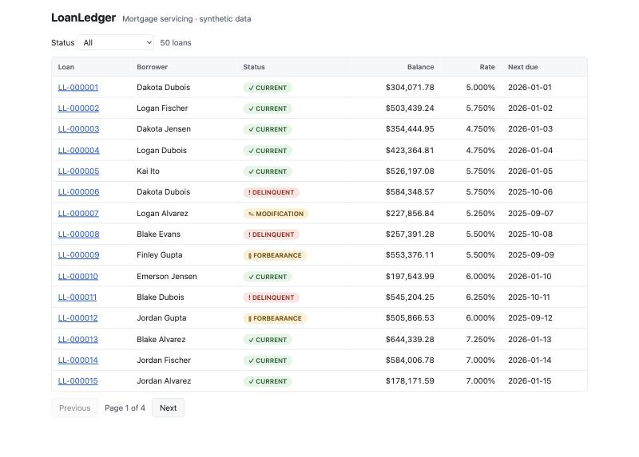
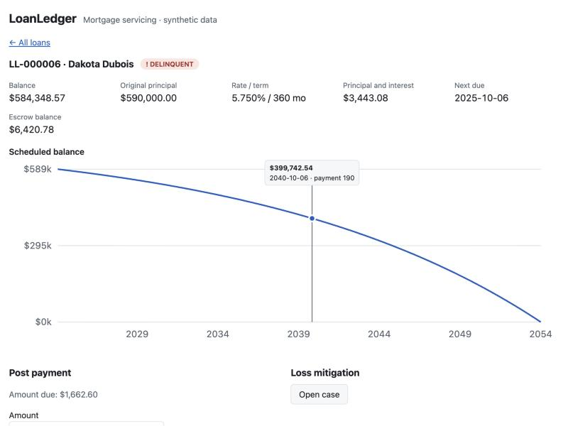
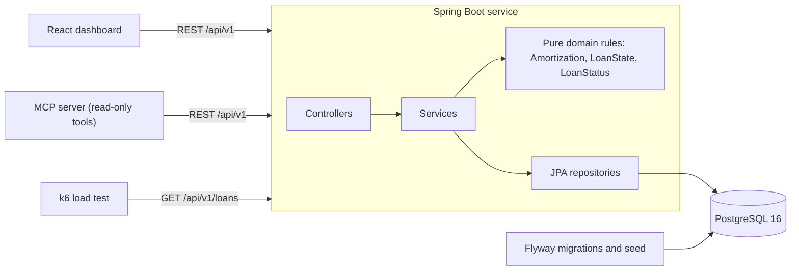

# LoanLedger

A cloud-native mortgage-servicing microservice: post payments, track escrow and move loans through loss mitigation, with a React dashboard on top.

[](https://github.com/abhiramvedipala/loanledger/actions/workflows/ci.yml)

All data is synthetic. The seed is generated with a fixed random seed, and every email is `@example.com`.

## Problem

After a mortgage closes, a servicer collects the payments for the next 30 years. Each payment has to be split correctly between interest, principal and escrow; people pay late, pay part, or pay extra; and borrowers in hardship move through forbearance or modification under strict rules. A wrong split or an illegal status change is a real financial and compliance problem.

LoanLedger is a small version of that system for a servicing operations team. I built it to practice the parts of backend work that matter when the data is money: exact decimal arithmetic, invariants enforced in the database, concurrency safety and clear API errors.

## Demo

Loans table with status chips:



Loan detail with the balance chart, payment form and loss-mitigation actions:



## Architecture



A request hits a controller, where Bean Validation rejects bad input as an RFC 7807 problem. The service loads the loan and hands its state to `LoanState`, a pure class that holds the money rules. The service then saves the new state and the payment in one transaction, and a `@Version` column turns a concurrent write into a 409. Spring serves the built dashboard from the same jar, so there is a single deployable, which runs under Compose or Kubernetes.

## Tech stack

| Tool | What it's used for | Why I chose it |
|---|---|---|
| Java 21, Spring Boot 3.5 | REST service | Mature, typed, and standard for financial backends |
| Spring Data JPA, Hibernate | Persistence | Optimistic locking and paging with little code; schema validation only |
| PostgreSQL 16 | System of record | `NUMERIC` money, check constraints and partial unique indexes |
| Flyway | Migrations and seed | Versioned schema, and its lock makes the seed safe with several replicas |
| springdoc-openapi | Swagger UI and OpenAPI JSON | Docs generated from the code can't drift from it |
| JUnit 5, Testcontainers | Tests | Integration tests run on real Postgres, not an in-memory lookalike |
| React, TypeScript, Vite | Dashboard | Typed client and a fast build; no router or chart library was needed |
| Docker, Compose | Packaging and local run | One command runs the whole stack |
| Kubernetes, kind | Deployment | Real manifests with probes and autoscaling, testable on a laptop |
| GitHub Actions | CI | Build, test and image build on every push |
| k6 | Load test | Scriptable, and its JSON summary feeds `RESULTS.md` directly |
| Python MCP SDK | Read-only tool server | Lets MCP clients query loans through the API's rules |

## Quick start

Prerequisite: Docker. Then:

```bash
docker compose up --build
```

- Dashboard: <http://localhost:8080/>
- Swagger UI: <http://localhost:8080/swagger-ui.html>
- Health: <http://localhost:8080/actuator/health>

Postgres is published on host port 5433. Set `APP_PORT` or `DB_PORT` if those ports are taken. To run the tests or the checks you also need Java 21 (`brew install openjdk@21`, then set `JAVA_HOME`), Node 22 and Python 3.

## Results

Every number comes from a script. This table is generated, and `scripts/check.sh` fails if it drifts from the raw files in `results/`. See [RESULTS.md](RESULTS.md) for how to re-run them and what the load test numbers do and don't mean.

<!-- results:start -->
| Metric | Value | Source |
|---|---|---|
| API endpoints (OpenAPI operations) | 11 | `scripts/count.sh` |
| Automated tests | 38 | `scripts/count.sh` |
| Test failures | 0 | `scripts/count.sh` |
| MCP server tests | 4 | `scripts/count.sh` |
| `GET /api/v1/loans` p95 latency | 61.77 ms | `scripts/results.sh` |
| `GET /api/v1/loans` median latency | 19.64 ms | `scripts/results.sh` |
| Throughput | 788 requests/s | `scripts/results.sh` |
| Requests in the 30-second run | 23672 | `scripts/results.sh` |
| Failed requests | 0.00% | `scripts/results.sh` |
| kind deploy: health | UP | `scripts/kind-up.sh` |
| kind deploy: ready replicas | 2/2 | `scripts/kind-up.sh` |
| kind deploy: app pod restarts during rollout | 0 | `scripts/kind-up.sh` |
| kind deploy: seeded loans via the Service | 50 | `scripts/kind-up.sh` |
| kind deploy: Kubernetes version | v1.37.0 | `scripts/kind-up.sh` |
<!-- results:end -->

## How it works

### Payment allocation

`LoanState.apply` is a pure function from state and amount to a new state. Money goes to interest, then principal, then escrow. A partial payment stops wherever it runs out and leaves the rest due. Once the installment is fully paid, the due date advances and any extra goes to principal, which lowers the next month's interest. A payment above the payoff amount gets a 422. The API, the simulate endpoint and the seed all call this one function, so they can't disagree.

### Amortization and rounding

The payment is `P * r / (1 - (1 + r)^-n)`, calculated with `BigDecimal` and rounded half-up to the cent. Because the payment is rounded, a small residual builds up over the term. On $300,000 at 6.5% over 360 months, the payment is $1,896.20 instead of $1,896.2041, so the last payment is $1,900.91 and total interest is $382,636.71 rather than the unrounded $382,633.47. I checked those figures with a separate Python calculation, and the tests pin them exactly.

### Loss-mitigation state machine

`LoanStatus` holds the only legal moves: CURRENT → DELINQUENT → (FORBEARANCE | MODIFICATION) → RESOLVED. Anything else is a 409 that lists the allowed next states. A case carries the loan through these states, and the loan's status changes in the same transaction. A partial unique index allows one open case per loan, so two concurrent requests can't both open one.

### Invariants in the database

Important rules are enforced by Postgres as well as the code. A payment row can't be stored unless `amount = principal + interest + escrow`, balances can't go negative, and Hibernate only validates the schema that Flyway owns. A bug in the service produces an error rather than bad money data.

### MCP server

`mcp-server/` exposes `get_loan`, `list_delinquent_loans` and `simulate_payment` to MCP clients. It only calls the REST API, so all the rules stay in one place, and it can't change data because the only POST it makes is to the simulate endpoint. Part of a real session, from [transcript.txt](mcp-server/transcript.txt):

```text
> simulate_payment({"loan_id": 6, "amount": 1662.6, "payment_date": "2025-12-01"})
{
  "paymentId": null,
  "loanId": 6,
  "paymentDate": "2025-12-01",
  "amount": 1662.6,
  "interest": 306.1,
  "principal": 643.08,
  "escrow": 713.42,
  "extraPrincipal": 0.0,
  "shortfall": 0.0,
  "balanceAfter": 583705.49,
  "nextDueDateAfter": "2025-11-06"
}

> get_loan({"loan_id": 999999})
error: Error executing tool get_loan: Loan 999999 not found
```

## Testing

```bash
export JAVA_HOME="$(brew --prefix openjdk@21)"
```

```bash
./gradlew test
```

```bash
scripts/count.sh
```

```bash
scripts/check.sh
```

The unit tests cover the known $300,000 / 6.5% / 360-month schedule, allocation edge cases (partial payments stopping in each bucket, overpayment, exact payoff, rejections, a full 360-payment run) and the state machine. The integration tests use Testcontainers to run the whole app on real Postgres, including the migrations and seed. The current counts are in the Results table.

`scripts/check.sh` is the definition of working. From a clean state it runs the tests, installs and builds everything, brings the stack up with the Quick start command, checks health, the seed and the dashboard, verifies the results files, and requires git to be clean and pushed. It prints `PASS` or the first failure.

To deploy to a local Kubernetes cluster and re-measure:

```bash
scripts/kind-up.sh
```

```bash
kind delete cluster --name loanledger
```

```bash
scripts/results.sh
```

## Design decisions and trade-offs

All of them are in [DECISIONS.md](DECISIONS.md). The top three:

1. **Money rules live in a pure class, not in the service or the entity.** `LoanState` needs no database or Spring to test, which is why I could test the allocation edge cases so cheaply. The cost is copying state between the entity and the record.
2. **Optimistic locking rather than row locks.** Two concurrent payments on one loan are rare, so I'd rather not hold locks; the loser gets a 409 and retries. Under heavy contention on a single loan, `SELECT ... FOR UPDATE` would be the better choice.
3. **The seed is a Flyway migration rather than a startup runner.** Flyway's lock means it runs exactly once even when several replicas start together. The trade-off is that demo data is tied to the migration history, so `FLYWAY_LOCATIONS` lets a real deployment leave it out.

## Known limits and next steps

- **No authentication.** Anyone who can reach the API can post payments. Spring Security with OAuth2 and role-based access is the first thing I would add before real use.
- **Double posting is possible.** A client that retries a successful POST creates a second payment. An idempotency key on the payment endpoint would fix it.
- **Delinquency isn't automatic.** A loan only becomes DELINQUENT through a case; nothing checks due dates on a schedule. A daily job would.
- **Interest is simplified.** It is monthly on the balance, with no daily accrual, late fees or escrow disbursements.
- **A modification doesn't change the loan's terms.** It is tracked as a status only, and RESOLVED is terminal.
- **Load test numbers are one laptop's baseline.** The load generator, app and database shared one machine, with other containers running.
- **On a phone, the chart's axis labels get small,** because the SVG scales down as a whole.
- **Postgres runs in the cluster for the demo.** In production I would use a managed database.

## Project structure

```text
.
├── src/main/java/com/loanledger/
│   ├── domain/        pure rules (Amortization, LoanState, LoanStatus), entities, repositories
│   ├── service/       transactions and rules that need the database
│   └── api/           controllers, request and response records, Problem Details
├── src/main/java/db/seed/          deterministic seed migration
├── src/main/resources/db/migration/  schema
├── src/test/          unit and Testcontainers tests
├── web/               React dashboard
├── mcp-server/        read-only MCP server, tests and transcript
├── k8s/               Deployment, Service, ConfigMap, Secret example, HPA, Postgres
├── scripts/           check, count, kind-up, loadtest, results
├── results/           raw results that RESULTS.md is rendered from
├── docs/              screenshots and interview notes
└── .github/workflows/ CI
```

For a reading order through the code and the commit history, see [docs/STUDY-GUIDE.md](docs/STUDY-GUIDE.md).
